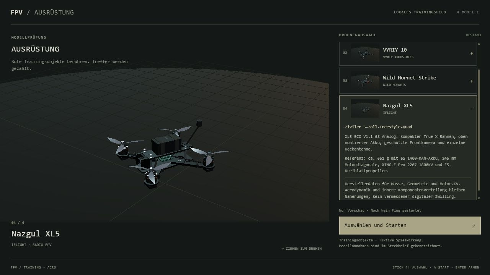

# FPV-Drohnensimulator

3D-Drohnensimulator im Browser, ausgelegt auf realistisches Flugverhalten aus der Pilotenperspektive. Motoren, Propeller und Flugsteuerung werden simuliert; geflogen wird mit Tastatur oder Gamepad. Code mit KI erstellt.

**[Windows-Paket herunterladen](https://github.com/LeNevio1337/FPV-Drohnensimulator/releases/latest/download/FPV-Drohnensimulator-Windows.zip)**

## Installation für Windows

Paket vollständig entpacken. Benötigt nur einen aktuellen Browser.

## Start

`Start.cmd` doppelklicken und im Hangar eine Drohne auswählen.

## Bedienung

- Schub auf null reduzieren, dann `Enter`: Motoren ein/aus.
- `W/S`, `A/D`, `Q/E`: neigen und drehen.
- `Leertaste/Umschalt`: Schub erhöhen/verringern.
- `P`: Pause · `R`: Hangar · `H`: Hilfe.
