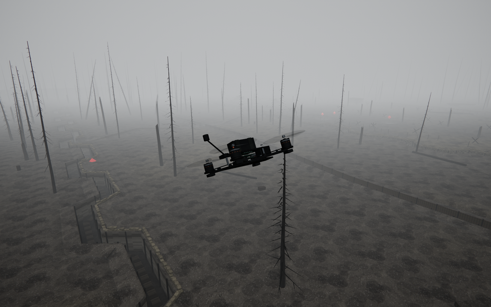
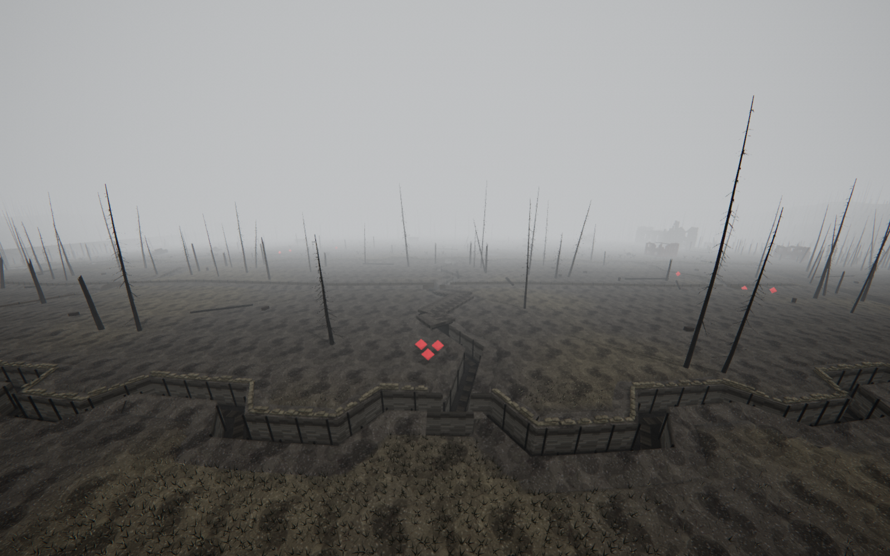

# FPV-Drohnensimulator

Mit diesem Simulator kannst du FPV-Fliegen (First Person View) in einer frei erkundbaren 3D-Umgebung ausprobieren. Im Hangar stehen vier Drohnen mit unterschiedlichen Flugeigenschaften zur Auswahl.

Die Simulation bildet Motoren, Propeller und Flugsteuerung ab und ist auf realistisches Flugverhalten ausgelegt. Gesteuert wird mit Tastatur oder Controller.

Die Idee zur düsteren Karte kam mir durch den Russland-Ukraine-Krieg. Die roten Markierungen stehen für Ziele, die du im Spiel mit der Drohne treffen kannst.

## Installation und Start

**[Windows-Paket herunterladen](https://github.com/LeNevio1337/FPV-Drohnensimulator/releases/latest/download/FPV-Drohnensimulator-Windows.zip)**

1. Die ZIP-Datei vollständig entpacken. Eine zusätzliche Installation ist nicht nötig.
2. `Start.cmd` doppelklicken. Der Simulator öffnet sich im Browser.

Benötigt wird ein aktueller Browser. Ein Controller kann zusätzlich angeschlossen werden.

## Einen Flug starten

1. Im Hangar eine Drohne auswählen und den Flug starten.
2. Den Schub auf null reduzieren und mit `Enter` die Motoren einschalten.
3. Den Schub mit der `Leertaste` langsam erhöhen und abheben.

### Steuerung mit der Tastatur

- `W/S`, `A/D`, `Q/E`: neigen und drehen.
- `Leertaste/Umschalt`: Schub erhöhen/verringern.
- `Enter`: Motoren ein/aus · `P`: Pause.
- `R`: zurück zum Hangar · `H`: Hilfe.

Zum Beenden den Browser-Tab schließen.
